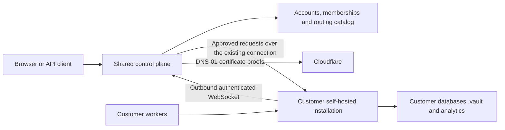
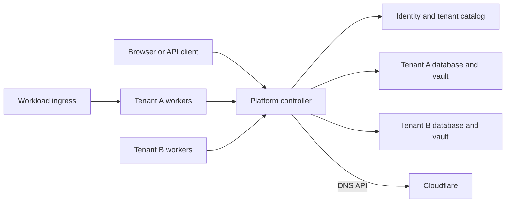

# Hosted instances

Doodship runs one shared `dispatch-platform` control plane. Its default backend
mode is `connected`. Customers connect complete self-hosted installations, each
with its own operational databases, credentials, queues, logs and execution.
The customer installation initiates an authenticated outbound WebSocket. The
control plane uses that connection for approved requests and does not dial the
customer's server.

The UI calls these installations instances. Catalog tables and existing API paths
continue to use `tenant`. Creating an instance records its name, membership and
WorkOS organization. It does not create an operational database or start a
customer backend on the control plane.

Read [Connect a self-hosted instance](tenant-servers.md) for enrollment, remote
access, worker traffic, application routing and disconnect behavior.

## Connected mode



The platform administrator can see instance metadata and aggregate usage. Access
to an instance's operational API requires active membership and an owner-approved
mapping to an active local account. Platform administration does not grant that
access. The local backend checks the mapped user's own permissions.

Remote user access is disabled by default. With it disabled, members open the
installation's configured URL on their LAN or VPN. Webhooks, approved node APIs
and published application traffic can still use the outbound connection. An
offline backend returns an unavailable response. There is no central execution
fallback and no managed worker allocation.

Use one root DNS record and an installation wildcard pointing at the control
plane. Instances use `<instance>.doodship.com`; published applications use flat
addresses such as `p223-<stable-id>-<instance>.doodship.com`. The existing wildcard
covers both. Creating an instance does not create a DNS record. Unknown hosts
return 404. Custom managed DNS records are disabled. Wildcard certificate keys
stay at the control-plane ingress.

Platform and instance sessions have different audiences and host-only secure
cookies. Opening a remote instance uses a one-use handoff bound to its HTTPS
origin and a PKCE verifier. Membership and account state are checked on API
requests and during live streams. Disconnect revokes installation credentials,
instance sessions and in-flight requests. Local accounts and running jobs remain
available on the customer server.

The customer backend reports daily aggregate usage. The catalog retains connected
instance reports for 90 days. These totals are customer reports, not independently
verified billing evidence. See [data isolation](tenant-data-isolation.md) for what
each side stores.

Only one controller may own a catalog at a time. Directory and PostgreSQL locks
enforce this. Active-active control-plane failover is not implemented.

## Prepare a connected control plane

Build `Containerfile.hosted` and run the controller in Docker. The
[development Compose guide](hosted-dev.md) includes a PostgreSQL catalog, ingress
proxy and private credential files. No systemd service or Docker socket mount is
required.

Connected mode needs a catalog login that owns only the catalog database. It does
not need a provisioner login, `CREATEDB`, `CREATEROLE`, or customer database URLs.
The legacy Compose preparation script may still create a provisioner credential
for embedded compatibility; connected mode does not use it to create customer
stores.

A direct TLS deployment uses settings such as:

```dotenv
DISPATCH_HOSTED_BACKEND_MODE=connected
DISPATCH_HOSTED_DATA_DIR=/var/lib/dispatch-platform
DISPATCH_HOSTED_ROOT_DOMAIN=doodship.com
DISPATCH_HOSTED_CATALOG_URL_FILE=/run/secrets/dispatch-catalog-url
DISPATCH_HOSTED_CONSOLE_ADDRESSES=192.0.2.10
DISPATCH_HOSTED_DNS_PROVIDER=cloudflare
DISPATCH_HOSTED_CLOUDFLARE_ZONE_ID=replace-with-zone-id
DISPATCH_HOSTED_CLOUDFLARE_API_TOKEN_FILE=/run/secrets/cloudflare-api-token
DISPATCH_HOSTED_ADDR=0.0.0.0:8443
DISPATCH_HOSTED_TLS_MODE=certificate
DISPATCH_HOSTED_TLS_CERT_FILE=/run/secrets/dispatch-console-chain.pem
DISPATCH_HOSTED_TLS_KEY_FILE=/run/secrets/dispatch-console-key.pem
```

Replace documentation addresses before use. Credential files must be private and
readable by the image's UID and GID `65532`. Keep the data directory private and
persistent. Configure WorkOS separately using [authentication](authentication.md).
TLS issuance and renewal use the same ingress settings described below for
embedded mode; neither depends on customer deployment jobs.

SQLite catalogs are available for disposable development with
`DISPATCH_HOSTED_ALLOW_SQLITE=true`. Connected mode creates no operational SQLite
files on the control plane.

Before accepting users, connect two self-hosted installations and check that
membership, local user mappings and worker credentials cannot cross between them.
Test remote access both enabled and disabled, disconnect during a log stream,
verify an offline webhook returns an unavailable response, and check a published
application through the outbound connection. Back up the catalog and ingress TLS
state centrally. Back up each customer's databases, keys and connection file on
its own installation.

## Existing installations

Existing embedded instances retain their recorded storage mode and data. Starting
the controller with the new connected default does not convert, move or delete
those operational databases. It also does not start their old central runtimes.
Set `DISPATCH_HOSTED_BACKEND_MODE=embedded` explicitly to continue serving them.

Moving data requires an export and restore onto a self-hosted installation, then
creating a connected instance and enrolling that installation. Automatic
conversion of an existing embedded catalog entry is not implemented. Verify the
restored data before retiring the previous backend.

## Legacy embedded mode

The following setup and execution instructions apply only when
`DISPATCH_HOSTED_BACKEND_MODE=embedded`. They describe the older arrangement in
which the control plane owns per-instance operational databases and runtimes.
They do not describe the connected default.

Hosted Dispatch runs as a separate `dispatch-platform` process. The existing
`dispatch` binary keeps its single-installation behavior. Use a new data directory
and catalog for hosted mode. This change does not convert or deploy the existing
server.

The platform account can create tenants and read tenant names, states, creation
dates, and usage totals. It cannot read applications, repositories, logs, secrets,
member lists, or deployment configuration. It cannot change a tenant after
creation. An explicitly granted tenant membership gives that same account the
permissions of its tenant role. Creating a tenant does not grant membership.

An owner manages tenant membership. An admin manages the tenant's operational
resources and can view membership. A member uses the existing project and team
grants. Only an owner can add, remove, or change members, and a tenant must retain
an active owner.

### Processes and data



The central catalog stores identities, memberships, sessions, DNS ownership,
provisioning state, and usage aggregates. Each tenant has its own database login,
database, encryption key, Git cache, artifacts, and analytics. See
[tenant data isolation](tenant-data-isolation.md).

The controller handles API requests and scheduling. Workers execute commands,
build images, and deploy to tenant targets. They connect outbound over HTTPS;
enrollment and work leases are tenant-scoped. See [workflow workers](workflow-workers.md).
Dedicated tenant workers may use their own Docker daemon. Managed workers run
simple jobs without network access, repository checkout, or a Docker socket.
Managed nodes still have an explicit tenant enrollment. Sharing a machine across
managed workers does not grant a worker access to another tenant's queue.

Only one hosted controller may use a catalog at a time. A PostgreSQL advisory
lock and a data-directory lock enforce this. Restart the controller to replace
it. This version does not provide active-active controller failover.

### Hostnames, sessions, and DNS

`doodship.com` serves global login, account settings, tenant selection, and the
platform directory. `agentops.doodship.com` serves that tenant's console.
Unknown hosts and deeper workload names never fall through to a tenant console.
Forwarded Host headers do not select a tenant.

Login creates a host-only secure cookie. Entering a tenant uses a one-use,
one-minute handoff bound to the tenant, HTTPS origin, and PKCE verifier. The
resulting cookie belongs to the exact tenant console host. Membership and account
state are checked on requests and live-stream refreshes. A platform cookie does
not authorize a tenant API. Existing tenant automation tokens continue to work
against that tenant's operational API.

Use an existing Cloudflare zone containing the root domain. Create the root
record and one wildcard per installation, both pointing to the control-plane
ingress. Tenant creation and deployment do not add DNS records.

| Name | Destination | Managed by |
| --- | --- | --- |
| `doodship.com` | Production ingress | Operator |
| `*.doodship.com` | Production ingress | Operator |
| `local.doodship.com` | Development ingress | Operator |
| `*.local.doodship.com` | Development ingress | Operator |

Tenant consoles use `agentops.doodship.com`. Workloads use one label, such as
`p223-<stable-id>-agentops.doodship.com`. The stable ID separates apps
and projects with the same PR number. Development uses the same layout below
`local.doodship.com`. Tenant names beginning with `p<number>-`, `pr-` or `app-` are reserved,
as is `local`. Long tenant names are shortened to keep the workload label within
63 characters; the stable ID is preserved.

Dispatch stores hostname ownership in the catalog. Deployment destinations and
configuration stay in the tenant database. Only registered hosts with a published
route reach the workload gateway. Unknown names return 404, even if DNS resolves
them. Custom tenant DNS records and custom Docker application domains are not
available. Existing custom DNS records survive migration, but cannot be edited
through Dispatch.

Set `DISPATCH_HOSTED_WORKLOAD_GATEWAY` to the operator's shared workload ingress.
It accepts the original Host and routes it to the target's published workload.
An explicit `http://gateway:8080` origin supports an ingress on a private Docker
network. HTTPS origins verify the upstream certificate. A bare IP or hostname
uses HTTPS on port 443. Public TLS terminates at the control-plane ingress;
workers do not receive its wildcard key.

This gateway requires connectivity to the workload ingress. It does not create
an outbound tunnel to private customer workers. Without a configured gateway,
published workload requests return 503. Helm chart ingress remains chart-managed.
See [DNS providers](dns-providers.md) for credentials, ownership and TLS.

### Preparing a new installation

These commands are for the new installation host. They are not an upgrade or a
migration procedure for an existing Dispatch data directory.

Build the hosted controller image from the repository root:

```sh
docker build -f Containerfile.hosted -t dispatch-platform:local .
```

Tenant workers run in their own containers or on separate hosts. The hosted
controller image contains no Docker CLI or socket mount.

Create a private data directory and credential files readable only by the service
account. Use PostgreSQL 16 or later with separate catalog and provisioner logins.
The catalog login owns its catalog database and does not need `CREATEDB`,
`CREATEROLE` or superuser access. The provisioner needs `LOGIN`, `CREATEDB`,
`CREATEROLE` and `NOINHERIT`, with `NOSUPERUSER`, `NOREPLICATION` and `NOBYPASSRLS`.
It needs `CONNECT` on the maintenance database in its connection URL.

The provisioner creates a restricted login and database for each tenant. It grants
itself permission to assume that tenant role with `INHERIT FALSE, SET TRUE`, then
uses `SET ROLE` to revoke public access to the tenant database. Tenant logins have
no role memberships. Tenant runtimes receive only their own database credentials.
See [tenant data isolation](tenant-data-isolation.md) for the access boundary.

Save these values in `hosted.env` for the controller container:

```dotenv
DISPATCH_HOSTED_BACKEND_MODE=embedded
DISPATCH_HOSTED_DATA_DIR=/var/lib/dispatch-platform
DISPATCH_HOSTED_ROOT_DOMAIN=doodship.com
DISPATCH_HOSTED_CATALOG_URL_FILE=/run/secrets/dispatch-catalog-url
DISPATCH_HOSTED_POSTGRES_ADMIN_URL_FILE=/run/secrets/dispatch-provisioner-url
DISPATCH_HOSTED_CONSOLE_ADDRESSES=192.0.2.10
DISPATCH_HOSTED_WORKLOAD_GATEWAY=192.0.2.20
DISPATCH_HOSTED_DNS_PROVIDER=cloudflare
DISPATCH_HOSTED_CLOUDFLARE_ZONE_ID=replace-with-zone-id
DISPATCH_HOSTED_CLOUDFLARE_API_TOKEN_FILE=/run/secrets/cloudflare-api-token
DISPATCH_HOSTED_ADDR=0.0.0.0:8443
DISPATCH_HOSTED_TLS_MODE=certificate
DISPATCH_HOSTED_TLS_CERT_FILE=/run/secrets/dispatch-console-chain.pem
DISPATCH_HOSTED_TLS_KEY_FILE=/run/secrets/dispatch-console-key.pem
```

The addresses above are documentation addresses. Replace them before use.
Credential files use mode `0600`, and the data directory uses `0700`. The catalog
URL and provisioner URL are PostgreSQL connection strings with TLS settings for
your database. The Cloudflare token needs Zone DNS Edit and Zone Read for only
the configured zone. Bind-mount the credential directory read-only at
`/run/secrets`. The image runs as UID and GID `65532`; that account must own the
private data directory and be able to read the credential files.

Before starting the controller, bootstrap the first platform account:

```sh
docker run --rm --env-file hosted.env \
  --mount type=bind,src=/srv/dispatch-platform,dst=/var/lib/dispatch-platform \
  --mount type=bind,src=/srv/dispatch-platform-secrets,dst=/run/secrets,readonly \
  dispatch-platform:local bootstrap-user \
  --email admin@example.com --name 'Platform administrator' \
  --password-file /run/secrets/dispatch-initial-password
```

The password must contain 12 to 72 bytes. Bootstrap only works on an empty identity
catalog. It cannot elevate an existing user or create another administrator after
accounts exist.

Without email delivery, verify the initial tenant owner's identity and create
their account before starting the controller:

```sh
docker run --rm --env-file hosted.env \
  --mount type=bind,src=/srv/dispatch-platform,dst=/var/lib/dispatch-platform \
  --mount type=bind,src=/srv/dispatch-platform-secrets,dst=/run/secrets,readonly \
  dispatch-platform:local create-user \
  --email owner@example.com --name 'Tenant owner' \
  --password-file /run/secrets/dispatch-owner-password
```

`create-user` creates an active, verified account. It refuses an existing email
and grants no platform role or tenant membership. After startup, sign in as the
platform administrator and create a tenant using that owner's email. Creation
assigns the existing account as owner without sending email. Give the owner their
initial password privately; they can change it in account settings after signing
in. Remove the initial password files after provisioning.

Start the controller:

```sh
docker run -d --name dispatch-platform --restart unless-stopped \
  --env-file hosted.env --publish 443:8443 \
  --mount type=bind,src=/srv/dispatch-platform,dst=/var/lib/dispatch-platform \
  --mount type=bind,src=/srv/dispatch-platform-secrets,dst=/run/secrets,readonly \
  --cap-drop ALL --security-opt no-new-privileges:true \
  dispatch-platform:local serve
```

Account provisioning and administrator recovery are offline commands. They take
the same directory and catalog locks as the controller. Stop the controller
before running either command on an existing installation, and use the same
catalog configuration and data mount.

To recover an existing platform administrator:

```sh
docker stop dispatch-platform
docker run --rm --env-file hosted.env \
  --mount type=bind,src=/srv/dispatch-platform,dst=/var/lib/dispatch-platform \
  --mount type=bind,src=/srv/dispatch-platform-secrets,dst=/run/secrets,readonly \
  dispatch-platform:local recover-admin \
  --email admin@example.com \
  --password-file /run/secrets/dispatch-recovery-password
docker start dispatch-platform
```

Recovery requires an active, verified platform administrator. It changes the
password and invalidates existing sessions and sign-in handoffs. It cannot create,
enable or promote an account, and tenant memberships stay unchanged. Remove the
recovery password file after use. Self-service forgotten-password recovery is
not available.

Email delivery is optional. Add SMTP settings to `hosted.env` to let invited
owners and other users register:

```dotenv
DISPATCH_HOSTED_SMTP_ADDRESS=smtp.example.com:587
DISPATCH_HOSTED_SMTP_FROM=dispatch@example.com
DISPATCH_HOSTED_SMTP_USERNAME=dispatch
DISPATCH_HOSTED_SMTP_PASSWORD_FILE=/run/secrets/dispatch-smtp-password
```

SMTP requires STARTTLS with certificate verification. Registration sends a
verification link; its recipient chooses the first password. If SMTP is not
configured, registration is unavailable. The initial tenant owner must be an
existing verified user, including an account created with `create-user`, or the
exact email recipient of an invitation. Invitations appear after that person
verifies and signs into their account. A platform admin cannot claim them on the
recipient's behalf.

SQLite is available for disposable development with
`DISPATCH_HOSTED_ALLOW_SQLITE=true`. It creates a catalog file and separate tenant
files under the new data directory. Production hosted mode expects PostgreSQL.

The root console's `/healthz` endpoint reports that the HTTP process is running.
`/readyz` also queries the migrated catalog and returns `503` during shutdown or
when the catalog is unavailable or uninitialized. Neither endpoint verifies DNS
publication, certificate issuance, worker availability or individual tenant databases.

### TLS bootstrap and renewal

Use `DISPATCH_HOSTED_TLS_MODE=certificate` with a trusted console certificate
while testing DNS-01 issuance. Keep its certificate and key paths configured.
Add these settings to `hosted.env` and recreate the container:

```dotenv
DISPATCH_HOSTED_ACME_DIRECTORY=https://acme-staging-v02.api.letsencrypt.org/directory
DISPATCH_HOSTED_ACME_EMAIL=operations@example.com
DISPATCH_HOSTED_ACME_ACCEPT_TERMS=true
```

Issuance runs independently of the TLS serving mode. Keep certificate or proxy
mode during staging tests, because staging certificates are not publicly trusted.
ACME serving mode rejects the Let's Encrypt staging directory.
After DNS-01 works, switch to the production directory and verify issuance. Then
use `DISPATCH_HOSTED_TLS_MODE=acme` if Dispatch should serve and renew the console
certificate itself. Without a bootstrap certificate, ACME serving becomes
available after the first successful issuance.

Renewal runs every five minutes, independently of builds and deployments. Existing
certificates remain available through renewal failures until they expire. The
controller publishes each DNS-01 TXT value through Cloudflare, checks the zone's
authoritative nameservers, then removes only that challenge's record.

The root, tenant consoles and flat workload hosts share a certificate for
`doodship.com` and `*.doodship.com`. The dev installation uses `local.doodship.com`
and `*.local.doodship.com`. Wildcard private keys stay at each installation's
control-plane ingress. Tenant certificate downloads are disabled. Cloudflare
receives only DNS-01 TXT proofs, never certificate keys.

A proxy container can terminate HTTPS instead. `DISPATCH_HOSTED_TLS_MODE=proxy`
requires a loopback listener, so the proxy must share the controller's network
namespace. Set trusted proxy CIDRs only for a proxy that replaces or correctly
appends `X-Forwarded-For`. The public Host and Origin checks still apply.

### Tenant creation and usage

The platform directory accepts a tenant name, slug, and initial owner email.
Creation returns `202` and a pending tenant. The controller retries provisioning
from durable state after failures or restarts. It creates the isolated database,
vault and directories, registers its console address, then marks the tenant active. A failed
attempt records a fixed provisioning phase, not raw database errors or tenant
content. Tenant slugs and the root domain are immutable in this version. The catalog
also binds the DNS provider and zone ID. Token rotation for that zone is allowed;
changing the provider or zone requires a deliberate migration.

Usage collection refreshes daily buckets once a minute. It exports current
project, application, and active membership counts, completed nonreused job
counts and execution seconds, and deployment counts. Job counts include failed
and cancelled jobs. Current-day values are partial; `updatedAt` records collection
time. `measured` explicitly lists available metrics. Storage, network transfer,
and workload runtime duration are not measured and must not be interpreted as
zero. Usage is operational telemetry, not an invoice calculation.

The platform API has no post-creation tenant mutation, impersonation, membership
override, operational resource, or credential endpoint. Membership changes use a
separate API that checks the acting account's tenant owner role. See
[hosted API](hosted-openapi.yaml) for routes and request contracts.

### Handoff checks

Before accepting users on a new installation:

1. Verify the root and installation wildcard resolve to the ingress. Create a
   test tenant and verify its console without adding DNS records. Check that
   provider outages do not prevent tenant creation.
2. Create two test tenants with different owners. Confirm platform-only access
   cannot enter either tenant, and tenant sessions and worker credentials cannot
   cross between them.
3. Register a dedicated tenant worker, run a build with live logs, cancel a run,
   and deploy to its intended target. Verify a managed worker cannot receive a
   tenant-mode build or repository credentials.
4. Complete staging DNS-01 issuance and test renewal without running a deployment.
   Verify a registered flat workload hostname uses the shared ingress certificate.
5. Back up the catalog, tenant databases, generated database credentials, vault
   keys, ACME state, and worker receipts. Test recovery into separate infrastructure.

Existing single-installation data is not imported automatically. An offline,
reviewed import and production provider/ingress configuration belong to the next
deployment task. Local provider fixtures cover ownership and retries. Live
Cloudflare publication still needs validation with an operator-supplied token.

### Hosted execution limits

Hosted mode rejects operations that still require local controller tools or files.
These include controller backup/restore, SSH installation, Laneway installation,
mounted kubeconfig paths, local repository paths, and interactive OpenShift login.
Direct Helm chart inspection, values and release previews, live deployment
topology and diagnosis, drift checks and reapply, and Helm rollback are also
unavailable. Deploy the desired chart revision to change a Helm release.

Tenant workload backups on enrolled Docker targets remain separate from
controller backup. Docker applications without shell hooks retain the existing
remote runtime's routing and rollback support. Hooked deployments run in the
isolated worker; combinations that require persistent managed-route state are
rejected until they have a remote implementation.

New Kubernetes target validation runs on the project's worker, including cluster
and namespace identity checks. Helm deployments, service provisioning, service
inspection and deletion, and Kubernetes storage inspection and deletion use the
worker queue. Deletion still requires the existing ownership and storage checks.
Private infrastructure provider calls require an enrolled relay.
Hosted HTTP integrations reject private, loopback, link-local and mixed public/
private DNS destinations at connection time. A DNS answer is validated and the
connection uses that exact IP, avoiding a second lookup that could change it.

Apply network egress policy to the control-plane host or container as well.
Git's SSH and HTTPS clients are external programs and do not use Go's HTTP
transport. Permit the configured database, SMTP service, Cloudflare API,
authoritative DNS queries for DNS-01, and required public Git/API endpoints.
Deny tenant-controlled access to cloud metadata and unrelated internal services. Private Git/secret/provider
access should use the tenant's enrolled connection. Do not place credentials or
mounts for workload execution on the control-plane process.
